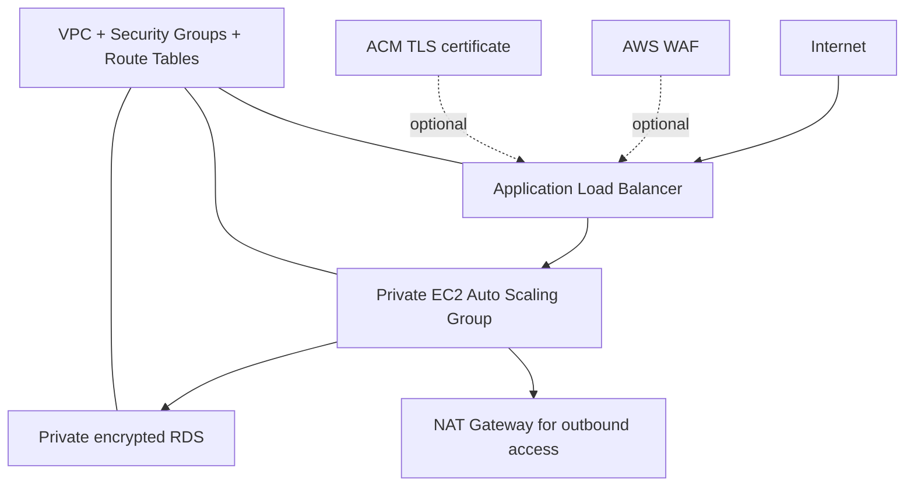

# AWS Cloud Security & Infrastructure Labs

**Four self-contained engineering exercises** covering cloud security architecture, network connectivity, hybrid VPN and FinOps controls. Designed as a practical portfolio for **Cloud Security, DevSecOps and Systems/Network Engineering**.

> **Status: educational AWS CLI scripts, not production IaC.** All deployment scripts require review in a dedicated AWS sandbox. Some actions create billable resources. No AWS environment has been provisioned or verified as part of this repository documentation update.

## Lab directory

| Lab | Focus | Technologies | Guide |
| --- | --- | --- | --- |
| **01 — Secure Web App** | Public/private segmentation, load balancing, compute, protected RDS and optional WAF | VPC, EC2, ALB, RDS, ACM, WAF | [Read guide](01_AWS_Cloud_Secure_WebApp/README.md) |
| **02 — Networking** | VPC Peering, routes, NAT and private endpoints | VPC, route tables, VPC endpoints | [Read guide](02_AWS_Networking_Lab/README.md) |
| **03 — Hybrid VPN** | Static-route IPSec connection between an on-prem gateway and AWS | VGW, CGW, AWS VPN | [Read guide](03_AWS_VPN_Site_to_Site/README.md) |
| **04 — FinOps** | Cost Explorer, CSV reporting, safely scoped cleanup, lifecycle transitions, Spot capacity | Cost Explorer, EC2, S3, EBS | [Read guide](04_AWS_Cost_Optimization/README.md) |

## Architecture — Lab 01



**Security principles:** layered controls, separation of public and private resources, restrictive security groups, encrypted storage, TLS where configured and controlled IAM roles.

## Prerequisites

- A disposable **AWS account or sandbox** with billing alerts and least-privilege IAM.
- AWS CLI authenticated to the intended account and region.
- Bash, curl, Python 3 (for CSV/JSON helpers).
- An explicit cleanup plan and approved budget.
- Real VPC, subnet, image, key-pair or gateway identifiers where required.

Always verify credentials and region before any experiment:

```bash
aws sts get-caller-identity
aws configure get region

# Safe, offline syntax checks:
find . -name '*.sh' -type f -print0 | xargs -0 -n1 bash -n
```

The repository now includes [static GitHub Actions validation](.github/workflows/validate.yml) for Bash syntax. **Static checks do not prove the AWS APIs will accept the infrastructure configuration.**

## Corrected scripts and safeguards

- **Secure Web App:** the VPC setup selects AZs for the specified region and requires a valid Flow Logs IAM role; compute deploy requires an existing AMI and SSH key, and does not redirect HTTP to a nonexistent HTTPS listener.
- **RDS:** credentials are requested through AWS-managed Secrets Manager rather than being generated and embedded in a shell variable; version and cost consent are explicit.
- **WAF:** the ALB is resolved by its AWS name; the S3 log bucket uses the prefix required by WAF.
- **Networking:** a read-only peering and route inspection helper is provided; a working end-to-end ping still needs test instances.
- **VPN:** real customer and VPC identifiers are mandatory; exported tunnel configuration is restricted and ignored by Git.
- **FinOps:** cost reports, an opt-in lifecycle example and tag-scoped cleanup review are available. Automatic deletion of EBS snapshots or volumes is deliberately excluded.

## Safety and cost boundaries

1. **Do not execute** these scripts in shared accounts, customer environments or production.
2. NAT Gateways, interface endpoints, ALBs, WAF, RDS, EC2 and VPNs may incur hourly charges.
3. AWS scripts are **not fully idempotent**; interrupted executions may leave resources behind.
4. Scripts that provision costly components require explicit review and selected interactive confirmation, but this is **not a replacement for IAM and budget guardrails**.
5. Do not store VPN secrets, customer configuration, AWS credentials or cost exports in Git.
6. Read-only reporting is distinct from infrastructure provisioning; check each command's AWS permissions and scope.

## Engineering roadmap

- Migrate all deployment scenarios to reproducible Terraform modules with policy tests.
- Add optional teardown scripts with resource tagging and protection against accidental deletion.
- Provide automated checks for cloud configuration drift and IAM least privilege.
- Create sanitized validation evidence (screenshots, service outputs and exact AWS costs).
- Document cross-account and region-safe deployment strategies.
- Verify all flows against an actual authorized sandbox before claiming operational completion.

## Interview/demo presentation

Present one lab at a time: **design decisions → security boundary → automation script → validation outputs → cost and security limitations → remediation**.

**Author:** [Yousef Gaddah](https://github.com/gaddah-yousef) — Cybersecurity & Cloud Computing portfolio.
