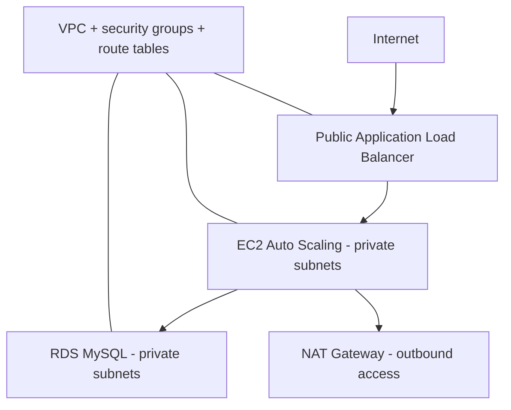

# AWS Infrastructure & Cloud Security Labs

A portfolio of **four hands-on AWS labs** covering secure application infrastructure, network connectivity, site-to-site VPN configuration and FinOps automation.

> **Current maturity:** this repository contains AWS CLI shell scripts and tutorial READMEs. These are **lab examples, not audited production-ready infrastructure**. Some guide commands point to scripts that are *not* in this repository, and some hard-coded values must be updated before deployment. Review the relevant scripts before issuing any command that creates or deletes AWS resources.

## Portfolio at a glance

| Lab | What it explores | Main AWS services | Technical focus |
|---|---|---|---|
| [01 — Secure Web App](01_AWS_Cloud_Secure_WebApp/) | Segmented web application environment | VPC, EC2, ALB, ASG, RDS, WAF | Network isolation and workload security |
| [02 — Networking](02_AWS_Networking_Lab/) | Private network routing and VPC connections | VPC, Peering, NAT, endpoints | AWS networking and routing |
| [03 — Site-to-Site VPN](03_AWS_VPN_Site_to_Site/) | Hybrid connection design | VGW, CGW, VPN | Hybrid-cloud connectivity |
| [04 — Cost Optimization](04_AWS_Cost_Optimization/) | Cost visibility and resource optimization | EC2, EBS, Elastic IP, Cost Explorer | FinOps and safe operations |

## Architecture — secure application lab



**Intended security controls:** separation of public/private subnets, security groups restricting application-to-database traffic, optional HTTPS and WAF, EBS encryption and VPC flow logging.

**Important implementation note:** the ALB HTTPS listener is *commented out* in `01_AWS_Cloud_Secure_WebApp/scripts/deploy_ec2.sh`; do not treat HTTPS as configured or operational until an actual ACM certificate and listener have been provided. The main guide currently refers to a `setup_alb_https.sh` helper that does not exist in this repository.

## Directory map

```text
AWS_Projets/
├── 01_AWS_Cloud_Secure_WebApp/
│   ├── README.md
│   └── scripts/
│       ├── setup_vpc.sh
│       ├── deploy_ec2.sh
│       ├── setup_rds.sh
│       └── setup_waf.sh
├── 02_AWS_Networking_Lab/
│   ├── README.md
│   └── scripts/
│       ├── vpc_peering.sh
│       ├── endpoints.sh
│       └── nat_gateway.sh
├── 03_AWS_VPN_Site_to_Site/
│   ├── README.md
│   ├── config/vpn_config.json
│   └── scripts/setup_vpn.sh
├── 04_AWS_Cost_Optimization/
│   ├── README.md
│   └── scripts/
│       ├── cost_cleanup.sh
│       └── spot_instances.sh
└── README.md
```

## 1 — Secure AWS Web Application

**Goal:** understand the security boundary between a public ingress, private application instances and private database infrastructure.

**Technical concepts:**
- VPC, two availability zones, public/private subnets and route tables.
- Internet Gateway and outbound NAT for private compute.
- ALB + EC2 Auto Scaling, target health checks and an example Flask service.
- Restricted security groups and encrypted EBS volumes.
- RDS MySQL and WAF provisioning scripts.

**Practical review points before any execution:** `deploy_ec2.sh` uses a static Amazon Linux 2 AMI ID and a placeholder SSH key name, and assumes the output generated by `setup_vpc.sh`. Validate the AMI in your selected region, check IAM permissions, configure HTTPS and check expected spending. `setup_vpc.sh` assumes a pre-existing IAM role for VPC Flow Logs; without it log delivery may fail.

Read the [lab README](01_AWS_Cloud_Secure_WebApp/README.md) and inspect the scripts, rather than using the original guide as an unattended deployment runbook.

## 2 — AWS Networking Lab

**Goal:** compare internal VPC communication with managed Internet egress and service-private endpoints.

Includes scripts for VPC peering, gateway-based connectivity and NAT. The [lab README](02_AWS_Networking_Lab/README.md) also mentions Transit Gateway and a connectivity test script that are **not implemented as separate scripts in the current tree**.

**Validation ideas:** verify peering status, CIDR non-overlap, both directions of route propagation, DNS resolution and effective security group/NACL policies. Do not infer successful end-to-end network connectivity solely from successful resource creation.

## 3 — AWS Site-to-Site VPN

**Goal:** illustrate the components of hybrid AWS connectivity: Customer Gateway, Virtual Private Gateway, tunnel settings and static routes.

The [VPN setup script](03_AWS_VPN_Site_to_Site/scripts/setup_vpn.sh) creates managed resources and writes the customer device configuration locally. It expects **real VPC, route table and public gateway parameters**—default placeholder values are not deployable. The script uses **static routing**, despite its ASN parameters; this is not a completed BGP deployment.

The guide references a configuration-download script not present in the tree; the actual `setup_vpn.sh` itself exports the configuration XML under `/tmp/vpn_customer_config.xml`.

**Security consideration:** VPN configuration material may contain sensitive tunnel parameters. Do not commit exported customer configuration or credentials to Git.

## 4 — AWS Cost Optimization

**Goal:** explore resource inventory, potential savings and cleanup trade-offs.

The current scripts are:
- `cost_cleanup.sh` — identifies unassociated Elastic IPs, detached volumes, older snapshots, load balancers and cost data. The script **defaults to dry-run** and requires explicit `--execute` confirmation for destructive operations.
- `spot_instances.sh` — demonstrates creation of a mixed-instances Auto Scaling Group and an **illustrative**, static price calculation. Its prices are not current live AWS quotes.

**Warning:** never run `--execute` in a shared account without validating ownership, retention requirements, backup restoreability and deletion impact. The original lab README references additional cleanup/reporting helpers not currently present.

## Prerequisites and safe workflow

- AWS account with a **dedicated sandbox**, billing alerts and least-privilege IAM.
- AWS CLI configured for the intended account and region.
- Bash and basic understanding of AWS networking, IAM and resource cost.
- An inventory and teardown plan **before** provisioning.

```bash
git clone https://github.com/gaddah-yousef/AWS_Projets.git
cd AWS_Projets

# Non-destructive inspection first:
find . -name '*.sh' -type f -print
aws sts get-caller-identity
aws configure get region

# Explicit syntax check of locally reviewed scripts:
bash -n 01_AWS_Cloud_Secure_WebApp/scripts/setup_vpc.sh
bash -n 03_AWS_VPN_Site_to_Site/scripts/setup_vpn.sh
bash -n 04_AWS_Cost_Optimization/scripts/cost_cleanup.sh
```

**No AWS deployment has been performed as part of this documentation update.** Resource creation can incur charges even if the terminal later reports an error.

## Security and engineering improvements

1. Replace hard-coded IDs and regions with validated parameters and environment templates.
2. Implement missing guide commands or remove their references in the sub-lab READMEs.
3. Add automated shell linting (`shellcheck`) and integration tests against isolated disposable environments.
4. Introduce Terraform modules, state handling and controlled tear-down, where appropriate.
5. Add AWS Config, CloudTrail and GuardDuty observability, with clear enabling and cost instructions.
6. Record validated screenshots, evidence and per-lab cost measurements without committing account IDs or secrets.
7. Add explicit resource tagging, ownership and deletion-protection policies.

## Skills demonstrated

**AWS networking · Cloud security architecture · IAM/least privilege concepts · Secure workload segmentation · Site-to-Site VPN concepts · Bash automation · FinOps practices.**

**Author:** [Yousef Gaddah](https://github.com/gaddah-yousef) — student cloud security portfolio.
