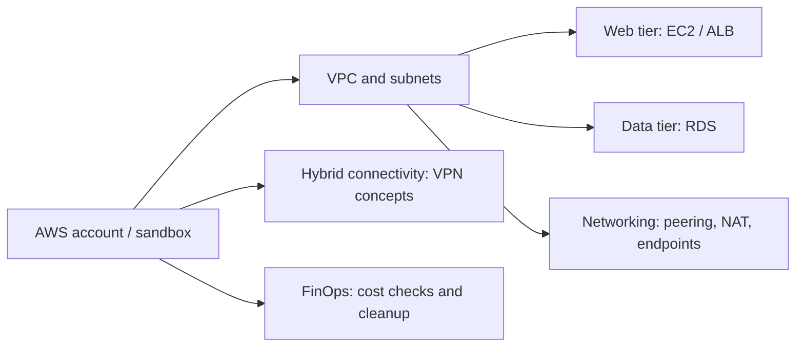

# ☁️ AWS Cloud & Security Labs
### Networking · Secure Architecture · Site-to-Site VPN · FinOps

**A collection of educational AWS infrastructure exercises with infrastructure scripts and architecture notes.**

[Explore the labs](#-lab-catalogue) · [Security considerations](#-security--cost) · [Cybersecurity portfolio](https://github.com/gaddah-yousef/SOC-LAB/blob/main/docs/portfolio/github-projects.md)

---

## 🎯 What this repository demonstrates

These labs explore AWS network segmentation, infrastructure building blocks, hybrid connectivity and cost awareness. Each exercise is documented separately; scripts are **learning materials**, not a production-ready deployment pipeline.

## 🗂️ Lab catalogue

| Lab | Focus | Entry point |
| --- | --- | --- |
| **01 — Secure Web Application** | VPC, public/private subnets, ALB, EC2, RDS and WAF concepts | [Architecture & scripts](01_AWS_Cloud_Secure_WebApp/README.md) |
| **02 — Networking Lab** | VPC peering, NAT Gateway and private connectivity patterns | [Networking exercises](02_AWS_Networking_Lab/README.md) |
| **03 — Site-to-Site VPN** | Customer Gateway, Virtual Private Gateway and IPSec concepts | [VPN lab](03_AWS_VPN_Site_to_Site/README.md) |
| **04 — Cost Optimization** | Resource cleanup, Spot Instances and cloud-cost awareness | [FinOps scripts](04_AWS_Cost_Optimization/README.md) |

## 🧩 Architecture at a glance

The diagram summarizes the **topics across the repository**, not one deployed environment.

## 🔍 How to review the work

1. Read the [secure web application lab](01_AWS_Cloud_Secure_WebApp/README.md) for segmentation and access-control design.
2. Review the [networking lab](02_AWS_Networking_Lab/README.md) to understand VPC routes and connectivity.
3. Inspect the shell scripts before executing any command; compare each guide with the **files actually present** in its folder.
4. Run static Bash checks where available, then test only in an **authorized, disposable AWS sandbox**.

> **Verification status:** repository content and scripts are provided as educational examples. This README does **not** claim a successful end-to-end AWS deployment.

## 🔐 Security & cost

- **Never commit** AWS access keys, SSH private keys or customer VPN secrets.
- Apply least-privilege IAM permissions; review the exact API calls before running a script.
- NAT Gateways, load balancers, RDS, public IPv4 addresses and VPN connections can incur **real charges**.
- Some sub-lab guides mention helper scripts that are **not currently included**. Use the repository tree as the source of truth.
- Review cleanup actions carefully; do not assume every script implements safe dry-run semantics.

## 👤 Author & related work

**Yousef Gaddah** — Cybersecurity & Cloud Computing Engineering Student, ENIM – Mines Rabat.

[GitHub profile](https://github.com/gaddah-yousef) · [SOC-LAB](https://github.com/gaddah-yousef/SOC-LAB) · [PME SecureOps](https://github.com/gaddah-yousef/pme-secureops)
